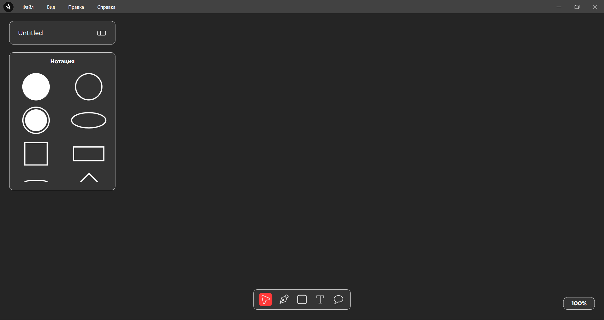

# Kapibara

Минималистичное и функциональное приложение для создания диаграмм в нотации UML Activity.

Программа написана на языке C# с использованием фреймворка WPF.

## Основные возможности
- Создание Диаграмм: Быстрое построение UML Activity-диаграмм с использованием интуитивно понятного графического редактора.
- Автосохранение: Ваша работа автоматически сохраняется, чтобы предотвратить потерю данных.
- Масштабирование: Используйте пункт меню «Вид» и пункт «Увеличить», для детального просмотра крупных диаграмм, или «Уменьшить».
- Упорядочивание: Объединяйте объекты в группы с помощью пула.

---

### Панель Инструментов и Элементы
#### 1. Фигуры
- Старт/Конец: Овал для обозначения начального и конечного узлов.
- Действие: Прямоугольник со скругленными углами.
- Решение: Ромб для условных ветвлений.
- Бар Синхронизации: Толстая горизонтальная линия для обозначения параллельных потоков.
- Другие фигуры: Прямоугольник, круг, квадрат.

#### 2. Стрелки
- Сплошная стрелка: Режим начертания стрелок можно активировать с помощью кнопки «Перо», которая находится на нижней панели.

#### 3. Инструменты редактирования
- Текст: Добавляйте подписи к фигурам и стрелкам. Возможность добавить текст, появляется после выбора на нижней панели режима «Текст». После создания текстового блока его можно отредактировать с помощью меню, которое появляется справа. Редактор поддерживает возможность менять шрифт, написание и размер текста. Для повторного редактирования необходимо дважды щелкнуть на текстовый блок.
- Заливка: Изменяйте цвет фона выбранных фигур. Блок «Заливка» позволяет менять цвет выбранного объекта.
- Контур: Изменяйте цвет границ фигур. В блоке «Обводка» можно задать цвет контура фигуры и цвет текста.
- Комментарии: Добавляйте комментарии в свою диаграмму. Включение режима «Комментарий» (находится на нижней панели), позволяет создать текстовый блок, помеченный красной точкой. После завершения редактирования текст скрывается. Наведя курсор на точку, текст можно увидеть. Комментарии не сохраняются при экспорте диаграммы.
- Упорядочивание: На Передний План: Перемещает выбранный объект поверх всех остальных. На Задний План: Перемещает выбранный объект под все остальные.
- Группировка: Выделите несколько объектов. Это позволяет перемещать и форматировать их как единое целое.
- Сетка: Активировать режим сетки можно в соответствующем меню вкладки «Вид». «Привязка к сетке» дает возможность располагать фигуры четко по сетке.

---

### Файловые Операции
- Сохранение: В меню «Файл» выберите «Сохранить» или «Сохранить как...». Вы можете экспортировать диаграмму в формат PNG с помощью пункта «Экспорт в изображение..».
- Открытие: «Файл» -> «Открыть...» для загрузки ранее сохраненного проекта.
- Автосохранение: Приложение автоматически сохраняет черновик вашей работы. 

---

### Горячие Клавиши (Сочетания Клавиш)
Для ускорения работы используйте сочетания клавиш:
- Ctrl + Z: Отменить последнее действие.
- Ctrl + Y: Повторить отмененное действие.
- Ctrl + X: Вырезать фигуру.
- Ctrl + С: Копировать фигуру.
- Ctrl + V: Вставить фигуру.
- Delete: Удалить выбранные объекты.

---

Kapibara — ваш надежный инструмент для чистого и быстрого моделирования бизнес-процессов и рабочих потоков. Приятного использования!
